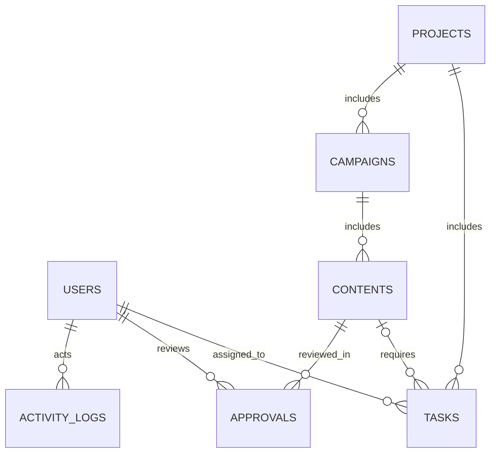

# Data Model (logical diagram)

Keys: `users.id`, `projects.id`, `campaigns.projectId`, `contents.campaignId`, `tasks.projectId`, `tasks.contentId` (optional), `tasks.assigneeId`, `approvals.contentId`, `approvals.reviewerId`. JSON collections maintain ID references with application checks instead of DB foreign keys.
